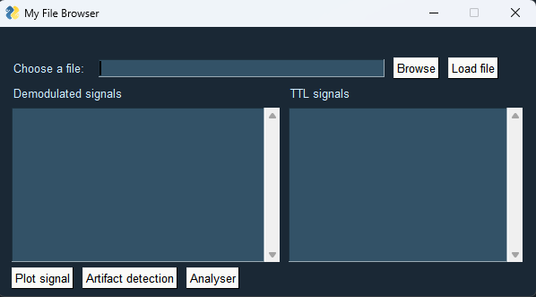
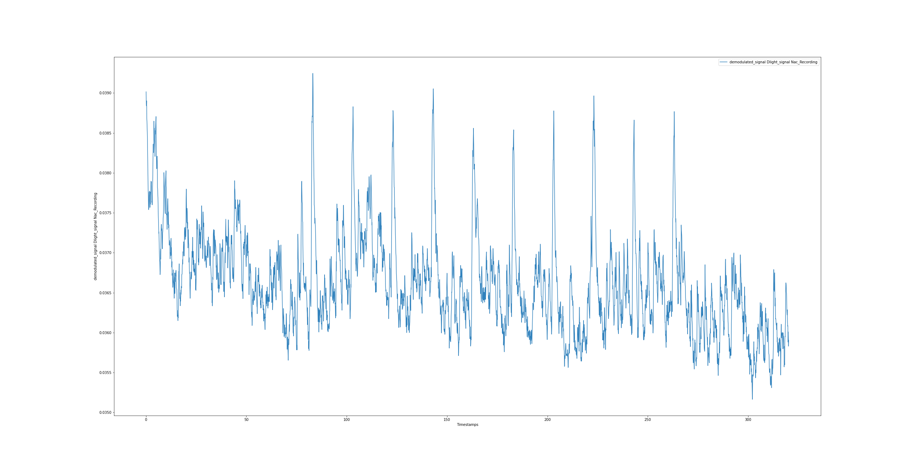
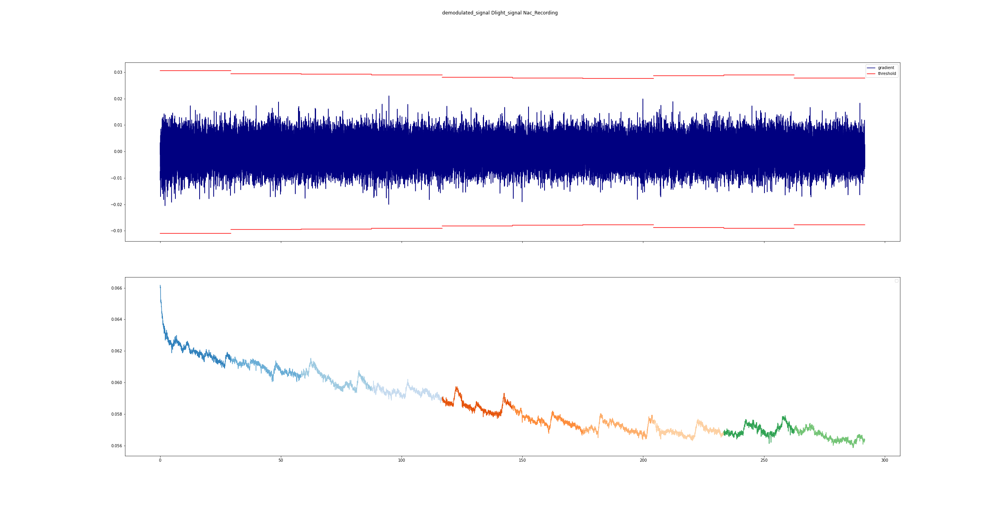
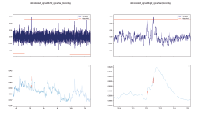
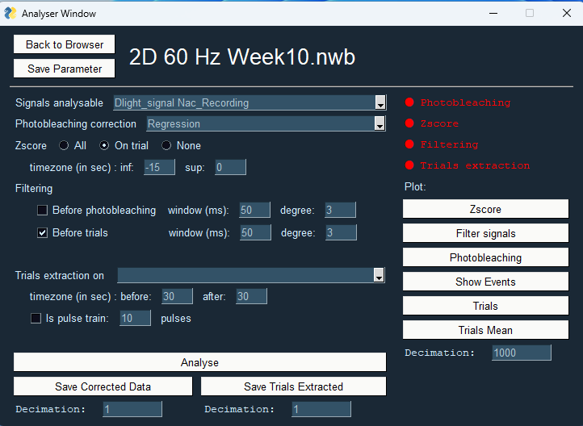

# GUI Analyzer Interface

This folder contain a [script](GUI_analyser.py) to launch a Graphical User Interface that allow you to quickly display and analyse your fiber photometric data that are saved as NWB files (for more information on this, check the [NWB builders documentation](https://github.com/PA-DERRIEN-INCI/Functionnal_Imaging_Electrophysiology/blob/main/fiberphotometry_tools/NWB_builders/README.md))

This interface is composed of 2 windows: 
- **The File Browser :** That allow you to select a NWb file and quickly check it's signal and artefacts
- **The Analyser :** Accessible from the **Browser** when you have selected your NWB file

## The Browser Interface

This interface is composed of several part:
- **File browser :** Clicking on the *Browse* button open a window file explorer that allow you to select the NWB file you want to analyse. The *Load file* button will load the file to allow the analysis and display the signal and TTL it contain.
- **The Signals browser :** This small window will display all the photometric signal you recorded and if there is an isobestic signals associated with it.
- **The TTL browser :** This small window will display all the TTL signal you recorded.
- **The Action Button :** 
    - *Plot signal* :  
    This button will display the unprocessed demodulated signals in function of time. If you dont select any signals in the signals browser, it will display all signals on one plot, on the other case it will only display the selected signals.
    
    - *Artifact detection* :  
    This button will run an windowed gradient detection on every channel to search and isolate anomaly in your signals. The result are a dual plot where the above signal represent the gradient and the under represent the signal, both in function of time. 
    
    If there are quick and important variation in the signal, the gradient will display spike at this timepoint. You can then zoom on your signal to identify if this is a real anomaly (Some function and option to handle this artifacts will come in the futur update).  
     
    - *Analyser* : This button is used to change to the **Analyser Window** 

## The Analyser Interface

This window will allow you to quickly setup an analysis and extract trials to then run further analysis on it. This interface is composed of several portion: 
- **The File portion** : This portion display the name of the analysed file and allow you to go back to the browser with the button *Back to Browser* and to save your analysis parameter (to a [Setting.json](Setting.json) file) with the *Save Parameter* button
- **Analysis portion** :  
This is the main portion of the analyser window. It allow you to select and configure the different parameter of the analysis
    - Analysable signal : Choose the signal to analyse based on the avalaible signal
    - Photobleaching correction : Choose between using a mono exponential regression and an isobestic based correction, to calculate the deltaF/F signal.
    - Zscore method : (Only one method can be selected)
        - None : no zscore is applied to your signal
        - All : Use the whole signal to calculate the Zscore. If you specify some timepoint in ce timezone inf/sup it will use them to restrain the zscore mean and std calculation to this timeframe.
        - On trial : the zscore calculation is done independently for each trials. You can define the timezone to calculate the mean and std using the timezone inf/sup. 

    - Filtering : This apply a savgol filter to your signal. 
        - before photobleaching : apply the filter before calculating the deltaF/F
        - before trials : apply the filter on each trial independently before the Zscore calculation   
    (both filter are independent)  

    - Trials extraction on : Select the TTL signal to use to identify the event timepoint to extract the trials. You need to define the time window to extract before and after the event with the timezone before/after box (in sec).
        - in the case of your TTL encode not a event but a pulse train. You can tick the box pulse train, and input the number of TTL event in each pulse to automatically convert them in one unique event.
    
    - Analyse button : This button is used to launch the analysis with the parameter defined.

    - Save Corrected Data :  This button allow you to save you deltaF/F, but also the filteered and Zscore done on the whole signals in excel or csv format. If the data are too long or to heavy to be saved, you can use the decimation factor to downsample your data when you save them. (NWB direct saving not implemented yet)

    - Save Trials Extracted :  This button allow you to save the trials extracted with there deltaF/F, Filtered and Zscore signals obtained by your analysis in excel or csv file format. (NWB direct saving not implemented yet). If need you can downsample your data by using the decimation value.

- **Display portion** :  
    This portion allow to quickly identify what you have done with the four indicator on top and display several signals view to confirm that analysis was done correctly.
    - Zscore : Display your detaF/F signal and Zscore signal overlap in function of time. This is a  two scale plot, with on the right the deltaF/F value and on the right the Zscore value
    - Filter signals : This display you signal pre-filtering and post-filtering. If you dont see difference between the two signal, it might just be due to the decimation factor that is too high.
    - Photobleaching : Display the raw signal, the delaF/F signal and the fit or isobestic correction depending on the method.
    - Show events : It will display the event time zone based on the selected TTL channel used in your analysis
    - Trials : Display each individual trials on plot centered around the event defined by your TTL
    - Trials Mean : Display the Mean and SEM of your signal centered around the event defined by your TTL
    - Decimation : by default only display 1 point every 1000 to allow for fast display, can be higher for less precision but quicker display.

## To Do
- [ ] Add an On Start / On End of event selector for Trials extraction
- [X] ~~Save the Analysis to NWB file~~
- [ ] Artifact handling methods and option
- [ ] Quality of life improvement
    - [ ] Block the use of isobestic correction if no isobestic signal avalaible
    - [ ] Autoreload of file when changing
    - [ ] Add Next file in folder button in Analyser and Browser