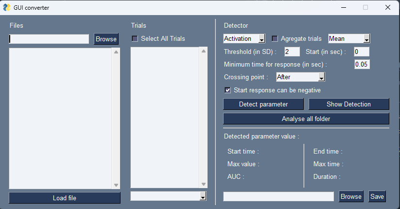

# GUI Detector Interface
This folder contain a [script](fiberphotometry_tools/GUI Interface/Parameter_detector/GUI_detector.py) to launch a Graphical User Interface that allow you to quickly detect and  display activation or inhibition after an event then calculate parameter to describe it. You can use this GUI on trials extracted by the GUI_analyser or custom data.  

If you use custom data, they must be in excel spreadsheet where:
- each sheet represent a signal data (ex: dF/f, Zscore, etc.)
- the first column correspond to the timestamps of each point that is share between all trials
- then each column correspond to a trial
- each row correspond to a data point for each timestamp.

[Image excel explication]

## Interface

This interface contain 5 main block: 
- **The folder/file selector**: use the Browse button to select the folder where you have all your file with you extracted trials. The files inside the folder will be display in the window beneath it. You can then select a file by clicking on it and use the load button to load the data into the programm. 
- **The analyzed trial selector**: this window will display all the trials present inside the loaded file you can select one or several trials you want to analyse by clicking on them. If you want to analyse all the trials inside it, just check the ***Select All Trials*** box.
Underneath the trials window, you have a dropdown menu to select the signal you want to do the analysis on.  
- **The detection parameter configurator**: this part is used to configure the parameter detection algorythm (more info in the Detection algorythm part) : 
    - **a drop down menu** allow to select if you want to detect activation, inhibition or both in your trial
    - **the agregate trials checkbox** allow you to combine all trials selected into one for the detection. You set the method used with the drop down menu. The actual method are Mean or Median, that respectively calculate the mean or the median of the selected trials to agregate for each timestamps point. If you select several trial but dont check the agregate method, the detection algorythm will be used on each trial individualy. 
    - **the threshold box** allow you to define the treshold use to detect when to consider their might be an activation or inhibition.  
    - **the threshold timezone box** that allow you to define a specific time zone where to calculate the Mean and SD of your signal. If leaved empty, it use all the data before your "0" time point (aka all the point in your trial before the event)
    - **the start** correspond to the first time, around the zero of your trials, where the algorythm will search for an activation or an inhibition
    - **the minimum time for response** correspond to the time needed above the detection threshold to consider the event as a valid response (activation or inhibition) 
    - **the crossing point parameter** is to define if you use the data point just before (under the threshold) or just after the threshold (above the trheshold) to calculate the parameters. 
    The start response can be negative checkbox allow the algorythm to define the starting point of the response before the zero of your data (the start of your event). If unchecked the start of the response is automatically set at zero if the first crossing of the threshold is before. 
    - **the detect parameter button** run the algorythm and display the result. 
    - **the show detection** button display the result of the detection if you closed it.
    - **the analyse all folder** button run the algorythm on all the file you have in your selected folder with the defined parameter. It then save all the detected parameter in an excel file inside a new folder in your current folder, and all the detection graph in a subfolder to allow visual inspection of the trace.
- **The parameter display**: this window display the different parameter that are calculated. (Don't update/work when used in **Both** method)

- **The saving option**: Currently in dev 

[!WARNING]
"%" mode not correctly implemented yet

## Detection algorythm

***Algorythm parameters*** :

The algorythm use a threshold based method to detect the response after an event. 
Depending on the selected method, it will detect the first activation, the first inhibition, or the first activation and the first inhibition after the Start.
The detection threshold is defined with the formula:  

$$ Threshold = Mean ± X*SD $$ 
with: 
- $Mean$ = mean of the data point in the time zone defined previously (***Threshold zone***) 
- $SD$ = Standard Deviation of the data point in the time zone defined previously (***Threshold zone***) 
- $X$ = User defined parameter (Threshold) in the GUI

The algorythm then define a research zone (represented by the green arrow) where it will search for each pair of threshold crossing. This zone is defined by the $Start$ parameter (defined in the GUI, represented by the dotted green line) until the end of the trial. 
In our example, the pair of crossing n°1 will not be detected as there before the defined research zone, but the pair of crossing n°2 and n°3 will be.

Then if the time between the crossing point are superior to the $Min Rep Time$ defined in the GUI (red arrow) then the pair of crossing point is defined as a valid response. In our exemple, the time between the point in the pair n°2 is superior to the $Min Rep Time$ and is classified as a valid response whereas the time between the point of the pair n°3 is inferior and is classified as not a real response.

If not valid response is find then the algorythm stop, if it find at least one valid response it calculate several parameters describe underneath.

***Response parameters*** :  

After detecting a valid response, the algorythm will calculate several parameter to describe the response.
- ***Start Rep*** : This value in seconds correspond to the first point where the response is above the threshold
- ***End Rep*** :This value in seconds correspond to the first point where  to the first point where the response is under the threshold
- ***Real End*** : This value in second correspond to the first point where the data comeback to the mean after the the start of the valid response
- ***Duration*** : This value in second correspond to the total time of the response, calculated byt the formula: $$Duration = Real End - Start Rep$$
- ***Max Time*** : This value in second correspond to the time point where the maximum of the response is reached
- ***Max Value*** : This value is in the same unit that the unit of the signal used and represent the maximum reached in the response.
- ***AUC*** : This value correspond to the area under the curve between the ***Start Rep*** and the ***Real End*** using trapezoidal rule (function used : sklearn.metrics.auc). This value represent the global intensity of the response and is affected by all the previous parameter and the shape of the response, the rise and decay of the response, etc...

## To do

[] Add a detect all activation/inhibition 

